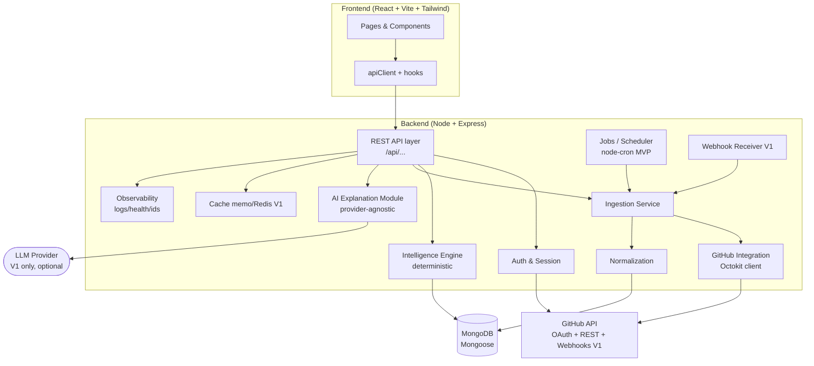
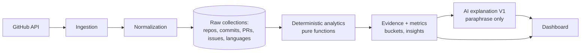
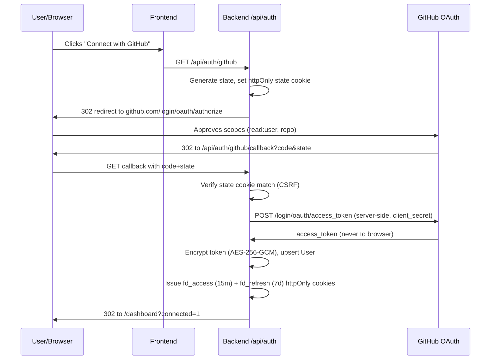
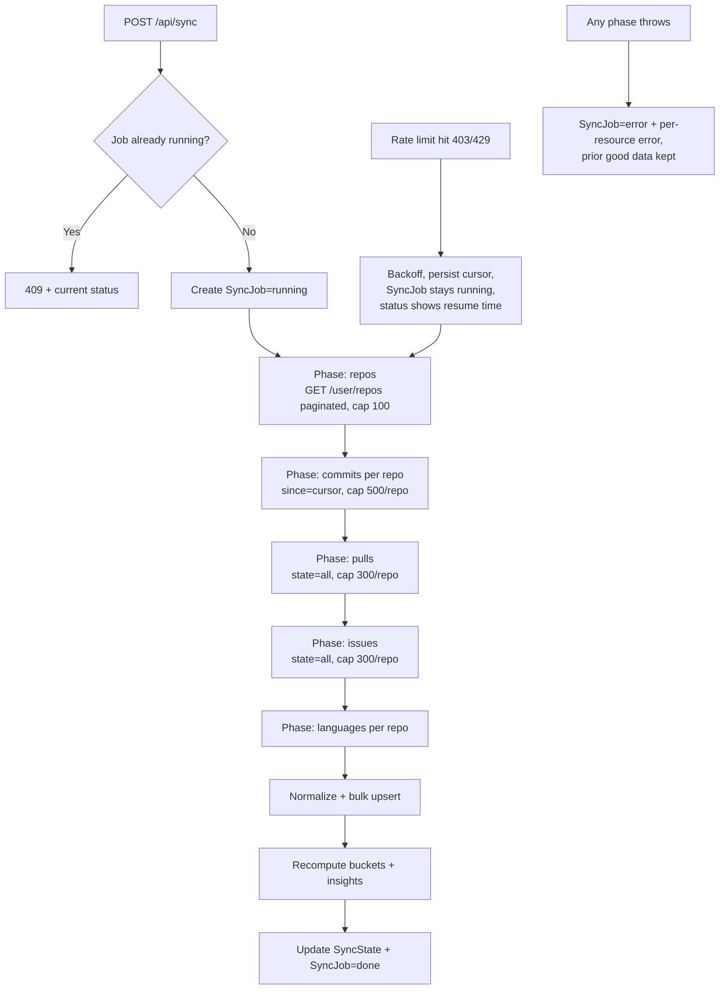
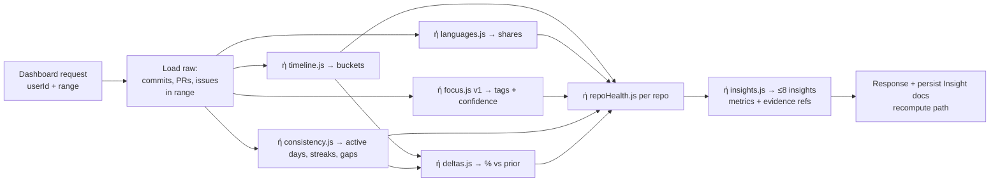
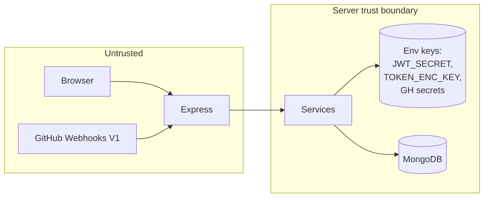

# Frieday — Technical Architecture

> Single Source of Truth for technical design. Companion docs: `prd.md`, `rules.md`, `design_system.md`, `agents.md`, `tasks.md`.
> Stack: React + Vite + Tailwind (frontend) · Node.js + Express (backend) · MongoDB (Mongoose) · GitHub REST (Octokit) · Provider-agnostic AI module.
> Last updated: 2026-10-03

---

## 1. Architectural Principles

1. **Evidence pipeline, not LLM pipeline.** Truth flows: GitHub → ingestion → normalization → stored data → deterministic analytics → evidence → (optional) AI explanation. The LLM never computes, stores, or alters metrics.
2. **Clean module boundaries.** Routes → controllers → services → models. No GitHub calls outside `services/github/`. No intelligence math outside `services/intelligence/`. No LLM calls outside `services/ai/`.
3. **Boring until scale demands otherwise.** MVP is a monolithic Express app + MongoDB + in-process scheduler. V1 adds Redis/BullMQ and webhooks without rewriting core logic.
4. **Idempotent, resumable sync.** Every ingestion job can be retried safely; partial progress is persisted in `SyncState`.
5. **Security boundaries explicit.** GitHub tokens encrypted at rest, never leave server. Auth middleware is the only gate to user data.

---

## 2. System Overview



**Request path (dashboard):** `React → apiClient → Express route → auth middleware → controller → intelligence service (reads Mongo, computes) → JSON → React renders + evidence links.`

**Sync path:** `POST /api/sync → job record → ingestion (GitHub REST, paginated, rate-limit aware) → normalization → upsert to Mongo → update SyncState → client polls GET /api/sync/status.`

---

## 3. Layer Responsibilities (1–13)

| # | Layer | Owns | Must NOT |
|---|-------|------|----------|
| 1 | Frontend | Pages, components, charts, hooks, apiClient, loading/empty/error UI per `design_system.md` | Call GitHub directly; compute canonical metrics; store tokens |
| 2 | API layer | REST routes, zod validation, auth middleware, pagination, error envelope | Business math; GitHub pagination logic; LLM prompts |
| 3 | Authentication | GitHub OAuth exchange, app JWT issue/verify, session cookies, disconnect/revoke | Store product data; call data endpoints |
| 4 | GitHub integration | Octokit wrapper, pagination, ETag/`since`, rate-limit backoff, DTO mapping | Persist to DB directly; compute intelligence |
| 5 | Data ingestion | Orchestrates per-resource sync (repos→commits→PRs→issues→languages), caps, progress, retries | Compute insights; render UI |
| 6 | Data normalization | Maps GitHub DTOs → Mongoose docs, dedupe, truncation, timestamp comparison | Call network; compute aggregates |
| 7 | Database | Schemas, indexes, queries, transactions where needed | Network calls; LLM calls |
| 8 | Intelligence engine | Pure functions: buckets, languages, focus tags, streaks, deltas, health, insight templates | Network, DB writes (reads via injected repos), LLM |
| 9 | AI/explanation layer | `AIExplainer` interface; template fallback (MVP); LLM paraphrase (V1) with validation | Compute metrics; persist truth; invent numbers |
| 10 | Background jobs | node-cron in-process (MVP: manual + initial; T7.2 adds the 6h staggered per-user scheduler); BullMQ+Redis (V1) | Anything synchronous on request path |
| 11 | Webhooks (V1) | HMAC verification, dedupe, enqueue incremental ingest | Trust unverified payloads; full re-sync per event |
| 12 | Caching | MVP: in-memory memo for aggregates (TTL 60s) + `SyncState.lastSyncedAt`; V1: Redis for aggregates + rate-limit state | Cache per-user data without user-scoped keys |
| 13 | Observability | pino logs + request/job IDs, `/api/health`, sync job history, client error toasts | Log tokens, secrets, or full commit diffs |

---

## 4. Directory Structure (authoritative)

```text
frieday/
├── prd.md
├── architecture.md
├── rules.md
├── design_system.md
├── agents.md
├── tasks.md
├── .env.example
├── package.json                 # root scripts (concurrently dev, lint, test)
│
├── client/                      # React + Vite + Tailwind frontend
│   ├── index.html
│   ├── vite.config.js
│   ├── tailwind.config.js
│   ├── postcss.config.js
│   └── src/
│       ├── main.jsx
│       ├── App.jsx              # Router + layout + auth gate
│       ├── styles/index.css     # Tailwind + design tokens (see design_system.md)
│       ├── lib/apiClient.js     # fetch wrapper: baseURL, credentials, error envelope
│       ├── lib/format.js        # dates, numbers (display only, NOT canonical metrics)
│       ├── hooks/               # useAuth, useSyncStatus, useDashboard(range), useRepo(id)
│       ├── store/               # light auth/sync state (context or zustand — one only)
│       ├── components/
│       │   ├── layout/          # Sidebar, Topbar, PageShell
│       │   ├── ui/              # Button, Card, Badge, Input, Modal, Toast, Tooltip, Skeleton
│       │   ├── charts/          # ActivityChart, LanguageDonut, RepoSparkline (Recharts wrappers)
│       │   └── domain/          # InsightCard, EvidenceExpander, RepoRow, SyncProgress
│       └── pages/               # Login, Dashboard, Timeline, Repositories, RepoDetail, Insights, Settings
│
└── server/                      # Node + Express backend
    ├── package.json
    └── src/
        ├── index.js             # bootstrap: env check, DB connect, app listen
        ├── app.js               # Express app: helmet, cors, cookies, routes, error handler
        ├── config/
        │   ├── env.js           # validated env (zod), caps, intervals, AI flags
        │   ├── db.js            # mongoose connect
        │   └── github.js        # OAuth + API config (clientId, scopes, base URLs)
        ├── routes/
        │   ├── auth.routes.js
        │   ├── sync.routes.js
        │   ├── dashboard.routes.js
        │   ├── repos.routes.js
        │   ├── insights.routes.js
        │   ├── webhooks.routes.js   # V1 (stub 404 in MVP with explicit TODO-V1 marker)
        │   └── health.routes.js
        ├── controllers/         # thin: validate → call service → shape response
        ├── middleware/
        │   ├── requireAuth.js
        │   ├── validate.js      # zod wrapper
        │   ├── requestId.js
        │   └── errorHandler.js  # error envelope { error: { code, message, details?, retryable } }
        ├── models/              # Mongoose schemas: User, Repository, Commit, PullRequest, Issue, LanguageSnapshot, ActivityBucket, Insight, SyncState, SyncJob
        ├── services/
        │   ├── auth/
        │   │   ├── oauth.service.js    # code exchange, state verify
        │   │   ├── session.service.js  # JWT issue/verify/refresh
        │   │   └── crypto.service.js   # AES-256-GCM encrypt/decrypt for GitHub tokens
        │   ├── github/
        │   │   ├── githubClient.js     # Octokit factory per user (decrypted token)
        │   │   ├── repos.fetcher.js
        │   │   ├── commits.fetcher.js
        │   │   ├── pulls.fetcher.js
        │   │   ├── issues.fetcher.js
        │   │   ├── languages.fetcher.js
        │   │   └── rateLimit.js        # header parsing, backoff, concurrency gate
        │   ├── ingestion/
        │   │   ├── sync.orchestrator.js  # job lifecycle, order, caps, progress writes
        │   │   ├── incremental.ingest.js # T7.2: single-repo since=lastSyncedAt ingest + stale guard
        │   │   └── cursors.js            # since/ETag persistence via SyncState
        │   ├── normalization/
        │   │   └── normalize.*.js       # one per resource: DTO → doc, dedupe keys, truncation
        │   ├── intelligence/
        │   │   ├── timeline.js          # bucketize (pure)
        │   │   ├── languages.js         # aggregate (pure)
        │   │   ├── focus.js             # focusRules v1 (pure, versioned)
        │   │   ├── consistency.js       # active days/streaks/gaps (pure)
        │   │   ├── deltas.js            # period comparison (pure)
        │   │   ├── repoHealth.js        # Active/Steady/Quiet/Stalled (pure)
        │   │   ├── insights.js          # template engine (pure) + priority + cap
        │   │   └── index.js             # compose → { metrics, insights[] } with evidence refs
        │   └── ai/
        │       ├── explainer.interface.js  # { explain(insightInput) → { paraphrase, whyItMatters? } }
        │       ├── template.explainer.js   # MVP default: returns template text
        │       ├── llm.explainer.js        # V1: OpenAI-compatible, validated, fallback
        │       └── validate.js             # allowlist number/repo/date check
        ├── jobs/
        │   ├── scheduler.js     # node-cron (MVP: disabled by default except manual; V1: 6h)
        │   └── sync.worker.js   # runs orchestrator (MVP in-process; V1: BullMQ handler)
        ├── webhooks/
        │   └── github.webhooks.js  # V1: verify, dedupe, map event → incremental ingest
        └── utils/
            ├── logger.js         # pino
            ├── pagination.js
            └── dates.js          # bucket boundaries (UTC, week starts Monday)
```

**Rule:** new files must live in the layer above. A GitHub fetcher in `controllers/` or an LLM call in `intelligence/` is a review-blocking violation (see `rules.md`, `agents.md`).

---

## 5. API Architecture

Base: `/api`. JSON only. Auth: cookies (`fd_access`, `fd_refresh`), `credentials: "include"`. Errors: `{ error: { code, message, details?, retryable } }` with matching HTTP status.

| Method | Path | Auth | Purpose | Notes |
|--------|------|------|---------|-------|
| GET | `/api/health` | no | Liveness + DB + GitHub reachability | `{ ok, db, github, version }` |
| GET | `/api/auth/github` | no | Start OAuth (sets `state` cookie, redirects) | |
| GET | `/api/auth/github/callback?code&state` | no | Exchange, upsert user, set session cookies, redirect to app | Validates `state` |
| GET | `/api/auth/me` | yes | Current user + connection status | `{ user: { login, avatarUrl }, connected, lastSyncedAt }` |
| POST | `/api/auth/refresh` | yes (`fd_refresh` cookie) | Rotate the session: reissue `fd_access` + `fd_refresh` under the same session id (sliding 7d window) | Validates the presented refresh against the persisted session + hash; a replayed/rotated token invalidates the whole session → 401 + both cookies cleared |
| POST | `/api/auth/logout` | yes | Clear session cookies | |
| POST | `/api/auth/disconnect` | yes | Revoke GitHub token (best-effort) + clear stored token | Data retained until delete |
| DELETE | `/api/auth/data` | yes | Full wipe: delete all user-scoped synced + derived collections and the user document itself | Returns accurate per-collection counts `{ deleted: { repositories, commits, ..., users } }`; reconnecting later starts from scratch |
| POST | `/api/sync` | yes | Enqueue/start sync (MVP: in-process, 1 at a time per user) | 409 if already running |
| GET | `/api/sync/status` | yes | Progress: `{ status, phase, done, total, perResource, error? }` | Poll every 2s |
| GET | `/api/dashboard?range=30d\|90d\|12m` | yes | Aggregates: KPIs, timeline buckets, languages, top repos, insights (template text in MVP) | Memoized 60s |
| GET | `/api/repos?sort=activity\|recent&limit&cursor` | yes | Repo list with health + counts | Cursor pagination |
| GET | `/api/repos/:id?range=90d` | yes | Repo detail + recent items + mini timeline | 404 if not owned/inaccessible |
| GET | `/api/timeline?range&repoId?&granularity=` | yes | Raw buckets for charts + CSV (V1 `&format=csv`) | |
| GET | `/api/insights?range=` | yes | Insight list with metrics + evidence refs | |
| POST | `/api/insights/:id/explain` | yes (V1) | AI paraphrase of one stored insight | MVP: 501 with `AI_DISABLED` code |
| POST | `/api/webhooks/github` | HMAC | GitHub events (`push`/`pull_request`/`issues`/`ping`) | T7.1 verified + deduped; T7.2 maps verified events to single-repo incremental ingest. Disabled (404 `WEBHOOKS_V1`) when `WEBHOOK_SECRET` is empty |

Validation: zod schemas in `controllers` via `validate.js`. Pagination: cursor-based for lists (`?cursor&limit≤50`); ranges allowlisted (`30d|90d|12m`).

---

## 6. Database Architecture

MongoDB via Mongoose. One database, collections per model below. All user-scoped queries include `userId`. Unique indexes on GitHub IDs for idempotent upserts.

**Schemas (essential fields):**

- `User { githubId!unique, login, avatarUrl, profileUrl, githubTokenEnc, tokenUpdatedAt, scopes:[String], createdAt }`
- `Repository { userId+githubId!unique-compound, owner, name, fullName, visibility, primaryLanguage, stars, fork, defaultBranch, githubUpdatedAt, lastSyncedAt }`
- `Commit { userId+sha+repoId!unique, messageHeadline (≤120ch), messageFull (≤500ch), authoredAt, additions, deletions, files:[String] (≤50 paths), repoId }` + index `(userId, authoredAt desc)`
- `PullRequest { userId+repoId+number!unique, state, title (≤200ch), createdAt, mergedAt, closedAt, additions, deletions, changedFiles, authorLogin, isAuthoredByUser, isReviewedByUser }`
- `Issue { userId+repoId+number!unique, state, title, createdAt, closedAt, labels:[String], authorLogin, isAuthoredByUser }`
- `LanguageSnapshot { userId+repoId+fetchedAt, bytes: Map<String,Number> }` (latest per repo used; history capped at 50 snapshots per user + repository)
- `ActivityBucket { userId+range+bucketStart (+repoId? for per-repo), commits, prsOpened, prsMerged, issuesTouched }` — pre-computed on sync completion for fast dashboard reads (recomputed, never hand-edited)
- `Insight { userId+range+templateId+generatedAt, title, text, metrics: Mixed (validated shape per template), evidence: { repoIds, commitShas?, prNumbers?, bucketStarts }, confidence: High|Medium|Low }`
- `SyncState { userId+resource!unique, status, lastSyncedAt, cursor (since/ETag), error }`
- `SyncJob { userId, status: queued|running|done|error, phase, done, total, perResource, error, startedAt, finishedAt }` (history capped at 20/user)

**Data flow (write):** fetchers return DTOs → normalization maps/truncates → `bulkWrite` upserts with `ordered:false` → update `ActivityBucket`s + `Insight`s via intelligence recompute → update `SyncState`/`SyncJob`.

**Data flow (read):** dashboard/timeline/insights/repos read from Mongo (+ pre-computed buckets/insights); no live GitHub calls on read path. If `SyncState` is stale, UI shows "Last synced X ago" — never blocks on fresh fetch.

**Raw vs. derived (hard rule):**



`RAW` is truth. `DET` is code. `AI` is wording. Recompute wipes and rebuilds derived collections from raw — AI outputs are never stored as truth.

---

## 7. GitHub OAuth Flow



Failure branches: state mismatch → 403 + "Try again"; user denies → redirect to `/login?error=denied`; token exchange fails → error page with retry; encryption-key missing at boot → server refuses to start (fail-fast).

---

## 8. GitHub Synchronization Flow



Rules: concurrency ≤2 GitHub requests; `per_page=100`; respect `Retry-After`; job timeout 15 min (MVP); idempotent upserts; progress written after each repo (`done/total`); client polls `GET /api/sync/status`.

---

## 9. Webhook Flow (V1 — implemented T7.1 + T7.2)

```mermaid
sequenceDiagram
  participant G as GitHub
  participant W as POST /api/webhooks/github
  participant Q as Queue BullMQ V1 / inline MVP-skip
  participant I as Ingestion
  G->>W: Event + X-Hub-Signature-256 + X-GitHub-Delivery
  W->>W: Verify HMAC with webhook secret; reject 401 if bad
  W->>W: Dedupe by delivery ID
  W->>Q: Enqueue { event, repo, sender }
  Q->>I: Incremental ingest (single repo, since=lastSyncedAt)
  I->>I: Timestamp-guard: ignore stale events
```

T7.1 implements the receiver boundary (HMAC → metadata → allowlist → shape validation → dedupe). T7.2 connects the trusted handler to **incremental single-repo ingest** (`services/ingestion/incremental.ingest.js`): the event's `repository.id` is resolved through the user-scoped `Repository` model (never a payload userId), the stale-event timestamp guard compares the newest verified event timestamp against the persisted `Repository.githubUpdatedAt`, and the run claims the existing per-user SyncJob single-flight (`kind: 'incremental'`) before fetching the ONE affected repo with `since = Repository.lastSyncedAt` through the existing T2.2 fetchers + T2.1 rate-limit gate + T3.2 persistence. No full user sync, no unrelated repositories. On success the per-repo boundary (`Repository.lastSyncedAt`) advances.

The BullMQ queue in the diagram remains V1/conceptual: the inline path is the implemented MVP boundary (see §16; tasks.md T7.2 "BullMQ+Redis migration path documented, not implemented unless Phase 2 perf forces it — owner decides").

---

## 10. Intelligence Generation Flow



All `ή` functions are pure (input records → output JSON), unit-tested with fixtures, versioned (e.g., `focusRules v1`). The `index.js` composer is the only place that touches DB (read raw, write derived on recompute). Request path may serve cached `ActivityBucket`/`Insight` docs when fresh (same `range` + `SyncState` unchanged), else recompute synchronously (MVP datasets are small).

---

## 11. AI Explanation Flow (V1; MVP returns template text)

```mermaid
sequenceDiagram
  participant U as User
  participant B as Backend /api/insights/:id/explain
  participant V as ai/validate.js
  participant E as AIExplainer
  participant L as LLM Provider
  U->>B: POST explain (insightId)
  B->>B: Load stored Insight (metrics + evidence)
  B->>E: explain({ templateId, text, metrics, evidenceSummary, range })
  alt MVP / AI disabled
    E->>B: Return template text (no network)
  else V1 LLM enabled
    E->>L: System prompt + strict JSON schema (numbers pre-filled)
    L->>E: { paraphrase, whyItMatters? }
    E->>V: Allowlist check (no new numbers/repos/dates)
    V->>B: Pass → return + label AI summary beta; Fail → discard + template text + log
  end
  B->>U: { paraphrase, evidenceUrl, aiLabel: true/false }
```

System-prompt excerpt (normative): *"You paraphrase a pre-computed developer insight. Do not invent numbers, repository names, dates, languages, or skills. Use only values in the input. If input is insufficient, reply 'Not enough data to summarize.' Keep under 80 words."* Timeout 10s, 1 retry, user-initiated only (no auto-generation on sync).

---

## 12. Error Handling

- Error envelope everywhere: `{ error: { code, message, details?, retryable } }`. Codes: `UNAUTHENTICATED`, `FORBIDDEN`, `VALIDATION_ERROR`, `NOT_FOUND`, `RATE_LIMITED`, `GITHUB_UNREACHABLE`, `SYNC_CONFLICT` (already running), `AI_DISABLED`, `WEBHOOKS_V1`, `INTERNAL`.
- Backend: `errorHandler.js` maps known errors → status; unknown → 500 + logged with request ID; never leaks stack or tokens to client.
- Sync: per-resource errors stored in `SyncState.error` + `SyncJob.error`; dashboard still renders good data with per-repo warnings.
- Frontend: `apiClient` throws typed errors; pages render inline error cards with Retry; toasts for transient; full redirect to `/login` only on 401.
- AI: any failure → template fallback, never a blocking error.

---

## 13. Security Boundaries



- GitHub tokens: AES-256-GCM encrypted (`crypto.service.js`), key from `TOKEN_ENC_KEY` (32 bytes, fail-fast if missing/invalid). Decrypted only in-memory per request, never logged.
- Sessions: `fd_access` (15m, HS256) + `fd_refresh` (7d, rotation). Cookies: `HttpOnly; Secure (prod); SameSite=Lax; Path=/`.
- Every user-data query enforces `userId === req.user.id` (middleware + service-level check; tests assert cross-user 403/404).
- Webhook HMAC verified before any processing. OAuth `state` verified. All inputs zod-validated. Helmet + CSP + HSTS (prod). No secrets in client bundle (Vite `VITE_*` contains only public base URL).
- See `rules.md` Security for the enforceable checklist.

---

## 14. Caching Strategy

- MVP: in-process `Map` memo for `GET /dashboard` and `GET /insights` keyed by `userId:range:lastSyncedAt`, TTL 60s, max 500 entries (LRU-ish eviction). No shared state assumptions (works with single instance; documented as non-sticky limitation).
- V1: Redis — cache aggregates (TTL 5 min), rate-limit counters, BullMQ queues. Keys always user-scoped (`fd:{userId}:dashboard:{range}`).
- Client: React Query-style `stale-while-revalidate` via hooks (or SWR-lite hand-rolled — one approach only); charts render from cache while refetching.

---

## 15. Observability

- Logging: `pino` JSON logs with `reqId` (per request) and `jobId` (per sync). Levels: `info` (sync phase transitions), `warn` (rate-limit backoff, AI fallback), `error` (failures with code, no PII/tokens).
- Health: `GET /api/health` → `{ ok, version, db: up|down, github: reachable|unreachable|rate-limited, uptime }`. Used by deploy checks.
- Sync history: `SyncJob` docs (last 20/user) visible in Settings ("Sync history").
- Frontend: console-error capture → toast in dev; no third-party telemetry in MVP.

---

## 16. Scalability Strategy

- MVP (1 instance): handles 100 users via staggered manual syncs + concurrency cap. Bottleneck is GitHub rate limits (5,000 req/hr/token — per-user tokens, so scaling is per-user, not global; documented).
- V1 (when p95 sync > 2 min or concurrent syncs queue): add Redis + BullMQ worker process (`sync.worker.js` moves out of web process unchanged), webhook-driven incremental syncs reduce full-sync frequency, pre-computed `ActivityBucket`s + Redis cache cut read load.
- Later (not committed): read replicas, aggregate rollup collections, GitHub App migration, multi-instance + sticky-free design (stateless API, shared Redis/Mongo). No microservices until team + load justify it.

---

## 17. Configuration (env)

See `.env.example` (authoritative list in `tasks.md` Phase 0). Key vars: `PORT`, `CLIENT_URL`, `MONGO_URI`, `JWT_SECRET`, `TOKEN_ENC_KEY`, `GITHUB_CLIENT_ID`, `GITHUB_CLIENT_SECRET`, `GITHUB_SCOPES`, `GITHUB_CALLBACK_URL`, `SYNC_*` caps (`SYNC_MAX_REPOS=100`, `SYNC_MAX_COMMITS_PER_REPO=500`, ...), `SCHEDULER_ENABLED=false` (opt-in; T7.2 = 6h staggered per-user incremental syncs via `jobs/scheduler.js`), `AI_ENABLED=false` (MVP), `AI_PROVIDER`, `AI_MODEL`, `AI_BASE_URL`, `WEBHOOK_SECRET` (V1). `config/env.js` validates with zod and fail-fasts with a named missing-var error.

---

## 18. Decisions & Assumptions (need owner sign-off where marked 🔶)

1. **OAuth App (not GitHub App) for MVP** — simpler, sufficient for user-owned data. Migrate later for org installs. 🔶 confirm.
2. **Mongoose (not native driver)** — schema validation + indexes worth the abstraction.
3. **Octokit REST (not GraphQL) for MVP** — fewer failure modes, easier rate-limit reasoning. GraphQL later for efficiency.
4. **node-cron in-process (not BullMQ) for MVP** — zero infra; V1 upgrades to BullMQ+Redis without changing intelligence code.
5. **Recharts for charts** — React-friendly, sufficient; no D3 custom work in MVP. 🔶 confirm (alternative: Chart.js).
6. **JWT cookies (not express-session)** — stateless API, easier to scale horizontally later.
7. Sync caps as in §8 — prevent runaway syncs; env-overridable. 🔶 confirm numbers.
